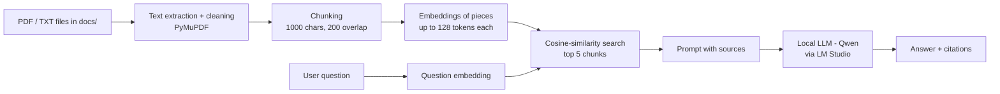

# Document Auditor and DocChat

This repository holds two local tools that share one document pipeline:

- **Document Auditor** finds contradictions between a company's documents and produces a cited report. Described directly below.
- **DocChat** answers questions about your documents. Described after the auditor.

## Document Auditor

Upload policies, procedures or contracts (PDF, DOCX, TXT). You get a report of where they contradict each other, with quotes, sources, PDF page numbers and a hint about which document is newer. Documents can be in Polish, English or other languages, including a mix: a German FAQ can be checked against an English policy. The interface and reports are in English, and quotes stay in the document's own language. Everything runs on your computer.

### Run it

1. Start LM Studio's server with a model loaded (tested with `qwen/qwen3.5-9b`).
2. Install dependencies with `pip install -r requirements.txt`.
3. Double-click `auditor.bat`, or run `python auditor_web.py` and open http://127.0.0.1:8000.

To try it without your own files, upload everything in `demo_docs/` (four fictional Polish company documents) or `demo_docs_en/` (an English handbook, an English IT policy PDF and a German FAQ). Both sets contain planted contradictions.

### Settings

| Variable | Default | Meaning |
|---|---|---|
| `LLM_BASE_URL` | `http://localhost:1234/v1` | Address of the local model server. If the app says the model is unavailable, check that this matches the port LM Studio is using. |
| `LLM_MODEL` | `qwen/qwen3.5-9b` | Model name as LM Studio shows it |
| `AUDIT_EMBED_MODEL` | `paraphrase-multilingual-MiniLM-L12-v2` | Embedding model used to choose which fragments to compare. `BAAI/bge-m3` also works, but it was slower and no better in testing (see below). |
| `AUDIT_EMBED_DEVICE` | `cpu` | Embeddings run on the CPU, so they don't compete with the language model for GPU memory |
| `AUDIT_CACHE_DIR` | not set | Test scripts only: saves model answers so unchanged requests aren't repeated. The app never sets it, because the saved answers contain document text. |

### How findings are checked

1. Each document is read as one continuous text. Sentences continue across PDF page breaks, and every sentence remembers the page where it starts, so citations point to that page.
2. Section headers are detected during reading: numbered or keyword headings in several languages (§, Rozdział, Section, Article, Kapitel...), all-caps headings and FAQ questions. Fragments never cross a section boundary.
3. Fragments from different documents are paired by topic, using embeddings.
4. The model judges each pair and must quote both sides. It also sees each fragment's section header.
5. **Each quote must appear word for word in its source, or the finding is dropped.** In testing this blocked citations the model had invented.
6. The code builds the "Difference" line only from values that appear in the quotes. When the model translates a value (writing "co 60 dni" for "every 60 days"), the code takes the matching number and its neighbouring words from the quote.
7. A finding goes to the "To review" section when no differing values can be found in its quotes, or when both sides contain the same numbers ("14 days" against "within 14 days"). Nothing is deleted at this step.

An earlier version re-judged each finding a second time from its quotes alone. It was removed: on real shop documents it pushed every real conflict into the review section, including the clearest one.

Uploaded files are deleted when the audit ends. The report stays in `audits/` until you delete it in the app. It contains quotes from the documents.

Reports download as A4 PDFs. Microsoft Edge or Google Chrome must be installed, because the app uses the browser in headless mode, with networking blocked, to print the PDF.

### Measured quality

| Test set | Conflicts found | In the main section | False alarms in the main section |
|---|---|---|---|
| `demo_docs/`: 4 Polish HR and IT documents | 6 of 6 | 6 | 1 |
| `demo_docs_en/`: English handbook and IT policy PDF, with the earlier Polish FAQ (now German, not yet re-measured) | 5 of 5 | 5 | 0 |
| Public pages of 3 real Polish online shops, 14 documents (measured with the earlier Polish prompt) | 5 of 9 | 5 | 25 |

Notes on these numbers:

- **The shop set is the honest one.** Its 9 conflicts were checked by hand. The two demo sets were written for this project, so treat them as smoke tests.
- **The English set includes two conflicts between an English document and one in another language,** and a PDF rule that breaks across two pages. With the earlier Polish FAQ, both were found, and the PDF citation points to the page where the rule starts. The FAQ is now German.
- **Most shop findings are still false alarms** (48 of 55), so every report needs a person to go through it.
- **Results vary between runs.** An earlier version found 7 of the 9 shop conflicts, but showed only 2 of them in the main section. The two it found and this version misses are also missed when section headers are removed from the prompt.
- **Section headers in the prompt reduce noise.** Without them, the same 5 shop conflicts were found, but with 59 false alarms instead of 50 (31 in the main section instead of 25), and the run took 21 minutes instead of 18.
- **The review rules were tuned on these same sets,** so the main-section numbers are optimistic until they're checked on new documents.
- **The prompt is now in English.** The demo rows were measured with it. The model now copies values untranslated ("every 120 days" instead of "co 120 dni"), but one decoy in the Polish set (office hours against working hours) now reaches the main section. The shop row still comes from the earlier Polish prompt and needs to be measured again.

Speed on an RTX 2080 SUPER: the three shops took 18 minutes together, 4–7 minutes each for 200 fragment pairs. The demo sets take 1–2 minutes.

### Tests

```bash
python -m pytest tests
```

```bash
python tests/eval_retrieval.py
```
Checks whether known conflicts reach the pairs the model judges. It doesn't call the model, so it takes about a minute. Name embedding models as arguments to compare them.

```bash
python tests/eval_demo.py
```
Polish demo set. Add `en` for the English set.

```bash
python tests/eval_shops.py
```
The shop set. The pages of the real shops are kept locally in `tests/real_shops/` and aren't committed.

The evaluation scripts save model answers in `tests/llm_cache/`, so re-scoring after a change to code-only rules takes seconds instead of the full run.

### Why the default embedding model stayed

`BAAI/bge-m3` was tested as a replacement. On the CPU it took about 2 minutes per shop instead of 10 seconds. It put 17 of the 20 known conflicts within the 200 judged pairs, against 19 of 20 for the current model, and both handled the English and cross-language pairs. Raising the number of neighbours per fragment from 4 to 8 made the bigger difference.

### Limitations

- A person should review every report. The verdicts, topics and severity levels come from a small local model.
- Reports show the exact differing values rather than a written explanation. The code builds that line only from values found in the quotes, so it can't add claims, but it also says nothing about business risk or which rule should apply.
- Only conflicts **between** documents are found, not within a single document.
- Scanned pages have no text and are skipped. The report lists them under "What wasn't checked".
- Each audit compares at most 200 fragment pairs, most similar first. The report says when this limit cuts anything off. In the shop tests, 1 of the 9 known conflicts ranked outside that limit.
- Section headers are recognised by their shape. Unusual layouts, such as headings that are only bold text in a PDF, are missed, and those fragments get no section.
- It has only been tested on small document sets. Large sets are untested.
- It's a single-user local app with no login or billing, and it isn't meant to be exposed to a network.

---

# DocChat: Local Document Q&A Assistant (RAG)

A desktop chat app that answers questions about **your own PDF and TXT documents**, using a language model that runs **entirely on your computer**. Every answer cites the file it came from and, for PDFs, the page number. No data is sent to the cloud.

> 📸 *Screenshot / GIF: the app answering a question with page citations*
> ``

## Why

Many companies can't paste internal documents into cloud chatbots for privacy reasons. This project shows how retrieval-augmented generation (RAG) can run fully locally with a free open-weight model (Qwen) served through LM Studio.

## Features

- **Ask questions about your documents** in Polish or English, with multilingual embeddings
- **Source citations** for every answer, e.g. `[report.pdf, p. 12]`
- **Streaming responses** in a desktop interface built with CustomTkinter
- **RAG on/off switch:** chat freely, or answer only from your documents
- **Thinking mode off:** requests send `reasoning_effort: "none"`, so answers start within seconds. With thinking on, Qwen3.5 spent up to about 2,000 tokens and 90 seconds before the first word, and that thinking counted towards the reply limit.
- **Reasoning-tag filtering:** hides any `<think>...</think>` blocks that Qwen3 models still produce
- **Prompt-injection guard:** document content is treated as data, not instructions
- **Conflicting sources are reported:** if documents disagree, the model lists every value with its source and doesn't pick one
- **Works with any OpenAI-compatible local server:** LM Studio, Ollama, vLLM or llama.cpp

## How it works



1. **Load:** PDFs are read page by page with PyMuPDF, keeping page numbers for citations. The text is cleaned: hyphenated line breaks are joined and page-number lines removed.
2. **Chunk:** text is split into overlapping 1000-character chunks so context isn't lost at chunk boundaries.
3. **Embed:** `paraphrase-multilingual-MiniLM-L12-v2` (sentence-transformers) reads at most 128 tokens and silently ignores the rest, while a 1,000-character chunk is about 220 tokens. So each chunk is split into pieces of whole sentences that fit the limit, counted with the model's own tokenizer, and every piece gets its own vector. The vectors are normalised, so a dot product equals cosine similarity.
4. **Retrieve:** the question is embedded the same way. The best-matching pieces are found, and the 5 whole chunks they came from are passed on, so the model still sees the context around each match.

Splitting into pieces made a measurable difference on the files in `docs/`. A sentence from the end of a chunk used to reach the model in 44 of 71 cases; now it does in 68 of 71. Sentences near the start of a chunk were already found 96% of the time.
5. **Generate:** the chunks are passed to the local LLM with a strict system prompt: answer only from the sources, cite each claim, and say so when the answer isn't in the documents. A low temperature (0.1) keeps answers factual.

## Tech stack

Python · sentence-transformers · NumPy · PyMuPDF · OpenAI Python SDK (pointed at a local server) · CustomTkinter · LM Studio · Qwen

## Getting started

### 1. Run a local model
1. Install [LM Studio](https://lmstudio.ai/).
2. Download a Qwen model. The project was tested with **Qwen3.5 9B** (`qwen/qwen3.5-9b`).
3. Start the local server in LM Studio (Developer tab). The default address is `http://localhost:1234/v1`.

### 2. Install
```bash
git clone https://github.com/Karol-K02/rag-bot.git
cd rag-bot
python -m venv .venv
.venv\Scripts\activate        # Windows
# source .venv/bin/activate   # macOS / Linux
pip install -r requirements.txt
```

### 3. Configure
The model name must match what LM Studio shows. Settings are read from environment variables:

| Variable | Default | Description |
|---|---|---|
| `LLM_BASE_URL` | `http://localhost:1234/v1` | Address of the local server |
| `LLM_MODEL` | `qwen/qwen3.5-9b` | Model identifier as shown in LM Studio |
| `LLM_API_KEY` | `lm-studio` | Placeholder; local servers ignore it |

```powershell
$env:LLM_MODEL="your-model-id"
```

### 4. Add documents and run
The `docs/` folder contains three sample company documents. Add your own `.pdf` and `.txt` files there, then:

```bash
python app.py
```

On Windows you can also double-click `docchat.bat`, which starts the app without a console window.

Turn on **Documents (RAG)** in the top-right corner. The first run downloads the embedding model (~470 MB).

**Try these questions with the sample documents:**
- *"Do I have to return my laptop when I leave?"* gets a single answer with a citation.
- *"How many vacation days do I get?"* is a conflict: the current policy and an outdated FAQ give different numbers, so the app reports both with their sources.
- *"What is the parking policy?"* isn't in the documents, so the app says so instead of guessing.

**Command-line version:**
```bash
python mini_rag.py "Your question about the documents"
```
It prints the retrieved chunks with their similarity scores, followed by the answer.

## Project structure

```
├── app.py             # Desktop app: chat UI, streaming, RAG toggle
├── mini_rag.py        # RAG pipeline: loading, chunking, embeddings, retrieval, generation
├── chat.py            # Minimal terminal chatbot (no documents)
├── docchat.bat        # Windows launcher without a console window
├── docchat.ico        # Icon for a DocChat desktop shortcut
├── auditor.py         # Document Auditor: contradiction detection pipeline
├── auditor_web.py     # Document Auditor: local web app and report rendering
├── auditor_ui.html    # Document Auditor: upload page
├── auditor_report.html# Document Auditor: report template
├── auditor.bat        # Windows launcher for the auditor
├── demo_docs/         # Fictional Polish documents with planted contradictions
├── tests/             # Unit tests and eval_demo.py quality check
├── requirements.txt
└── docs/              # Documents to search; only sample_* files are published
```

## Limitations

- **Scanned PDFs** have no text layer and are skipped. OCR isn't supported yet.
- **The index lives in memory** and is rebuilt each time RAG is switched on, which is fine for dozens of documents but not thousands.
- **Chunking is by characters**, not sentences or sections, so a chunk can cut a sentence in half.
- **Answer quality depends on the local model.** Small models sometimes ignore citation instructions.
- **Answers follow the language of the question.** The interface and prompts are in English; questions and documents can be in English, Polish or other languages.

## Possible next steps

- Store the index in a vector database (e.g. FAISS or Chroma) so it isn't rebuilt each time
- Split text by sentences or sections instead of fixed character counts
- Add OCR for scanned PDFs
- Evaluate retrieval quality on a small set of test questions (e.g. hit rate @5)

## Author

**Karol Kołodziejczyk** · Business Informatics MSc, Wrocław University of Economics
[LinkedIn](https://www.linkedin.com/in/karol-kolodziejczyk-pl) · [GitHub](https://github.com/Karol-K02)
